# Plataforma de limites e autorização de transações

Implementação do desafio técnico POD99 (Nova Plataforma de Finanças, Arquiteto de Aplicação): autorização síncrona de
transações com reserva de limite por contrato, eventos de domínio para consumidores desacoplados e integração com um
core legado simulado. Python 3.13, arquitetura hexagonal, AWS (sa-east-1) com Terraform. O ambiente local roda na
LocalStack, sem conta AWS.

Repositório: https://github.com/giovanedms/desafio-zup. O ZIP da entrega é um `git archive` do HEAD (`make zip`), sem
o histórico de commits e sem as execuções da esteira.

## Arquitetura

Três bounded contexts, um serviço por contexto, cada um com as próprias tabelas (ADR-0002).

| Serviço | Contexto | Runtime na AWS | Tabelas (DynamoDB on-demand) | Responsabilidade |
|---|---|---|---|---|
| `autorizacao` | Autorização de Transações | ECS Fargate; API Gateway REST → VPC Link → NLB | `autorizacoes` (GSIs esparsos `gsi_orfas` e `gsi_vencimentos`), `autorizacoes-outbox` | API pública, idempotência, decisão, ciclo de vida da autorização e do hold, publicação de eventos |
| `limites` | Gestão de Limites | ECS Fargate; chamado pelo `autorizacao` via Service Connect | `limites`: um item por contrato, com Stream | saldo do contrato: concedido, utilizado, reservado e holds |
| `contabilizacao` | Contabilização | Lambda, gatilho SQS | `contabilizacao-lancamentos`, `contabilizacao-inbox` | lançamentos em partidas dobradas a partir dos eventos |

| Componente de apoio | Runtime | Função |
|---|---|---|
| `reconciliador` | ECS, mesma imagem do `autorizacao` | retoma autorizações com lease vencido e expira reservas pelo `gsi_vencimentos` |
| `limites-acl` | ECS | consome a fila `legado-contratos` (registros de tamanho fixo do core legado) e aplica no item do contrato por versão |
| `relay` e `sweeper` | Lambda | publicam o outbox no bus `financas`: Stream da tabela e varredura a cada 5 min |
| `relay-cdc-limites` | Lambda | Stream da tabela `limites` → evento `LimiteAlterado` |
| consumidores de referência | Lambda | antifraude e notificações: validação pelo schema e inbox própria (`desafio-consumidor-*-inbox`) |
| data platform | EventBridge → Firehose → S3 | eventos particionados por tipo e data, SSE-KMS |

Borda: AWS WAF, Cognito (client credentials com escopo), API key e usage plan por canal. Mensageria: bus EventBridge
`financas`, uma regra por consumidor, cada regra com fila SQS e DLQ; schema registry `financas` com os 8 schemas de
evento.



Os cinco diagramas (contexto, containers, sequência da autorização, fluxo de eventos e implantação na AWS) estão em
`docs/arquitetura/diagramas/`, com o fonte Mermaid, SVG e PNG. Descrição completa em
`docs/arquitetura/documento-de-arquitetura.md`.

## Mecanismos

### Reserva de limite (ADR-0005)

Cada operação no limite é um único `UpdateItem` no item do contrato. O domínio descreve a operação como um `Plano`
(pré-condições e efeitos) e o adapter o compila na expressão (`limites/adapters/outbound/dynamodb.py::compilar`). Para
um DEBITO de valor `v`:

```
ConditionExpression  attribute_exists(id_contrato) AND attribute_not_exists(ops.<id_operacao>)
                     AND status = 'ATIVO' AND disponivel >= :v AND id_conta = :conta
UpdateExpression     SET versao = versao + 1, ops.<id_operacao> = :agora,
                         utilizado = utilizado + :v, disponivel = disponivel + :dd     (:dd = -v)
```

- O DynamoDB serializa as escritas no mesmo item: não há leitura prévia nem conflito de concorrência a tratar.
- Condição falhou: o item antigo volta no próprio erro (`ReturnValuesOnConditionCheckFailure=ALL_OLD`) e
  `Limite.diagnosticar()` dá o motivo (limite insuficiente, contrato inativo, conta divergente, operação já aplicada).
- `ops` é a guarda de idempotência no próprio item (5 min). As entradas vencidas saem no `REMOVE` da escrita seguinte do
  mesmo contrato, sem escrita extra.
- `TransactWriteItems` não é usado no item disputado: transações concorrentes no mesmo item são canceladas
  (`TransactionConflict`), custam o dobro de WCU e não devolvem o saldo resultante.
- Consequência: teto de ~8 operações/s sustentadas por contrato (ADR-0016, com o desenho de reserva fragmentada para
  contratos acima disso).

### Idempotência e falhas (ADR-0006)

- `id_autorizacao` = UUIDv5 de (client_id do token, método, URI, `Idempotency-Key`). O item da autorização é o próprio
  registro de idempotência; a janela é a retenção da autorização (30 dias).
- Primeira escrita: `PutItem` com `attribute_not_exists(pk)`, estado `EM_PROCESSAMENTO` e lease de 10 s. Se o item já
  existe, ele volta no erro:
  - mesmo pedido (SHA-256 do JSON canônico) concluído: 200 com o corpo original, byte a byte, e `Idempotent-Replayed: true`;
  - mesmo pedido em processamento: 409 com `Retry-After`;
  - pedido diferente com a mesma chave: 422 `IDEMPOTENCY_KEY_REUTILIZADA`.
- Orçamento de tempo: timeout do cliente ~2 s < lease 10 s < graça do reconciliador 60 s < prazo de reaplicação 4 min <
  guarda do limite 5 min. O `limites` usa 3 tentativas no total no DynamoDB (`total_max_attempts: 3`), o que limita a
  escrita mais tardia a ~38 s depois do envio.
- Sem retomada pela mesma chave, o `reconciliador` conclui ou compensa a autorização órfã por uma máquina de estados
  gravada passo a passo. Passado o prazo de reaplicação, a autorização vai para a fila humana (`RM#`) com o motivo.

### Eventos (ADR-0007, 0008, 0009)

- A conclusão grava o estado da autorização e o evento no outbox na mesma `TransactWriteItems` (itens desta
  autorização, sem contenção). O `relay` lê o Stream do outbox; o `sweeper` publica o que ficou para trás.
- Formato CloudEvents 1.0 no `detail` do EventBridge, com a versão no sufixo do `type`
  (`...financas.autorizacao.TransacaoAutorizada.v1`). JSON Schemas em `contracts/events/`.
- Evolução de schema verificada na CI (`make compat`): mudança incompatível reprova, e palavra-chave do JSON Schema
  que o gate não conhece também reprova.
- Entrega at-least-once. Os consumidores deduplicam pelo id do evento (inbox) e não dependem de ordem.



- Medido na AWS: o EventBridge reserializa números do `detail` (`1.00` → `1.0`, `99999998.88` → `9.999999888E7`);
  o valor fica preservado até ~15 dígitos significativos (ADR-0011).

### Hold: reserva, captura, estorno e expiração (ADR-0020)

- A RESERVA grava o hold no mapa `reservas` do item do contrato. Captura é um DEBITO com `id_autorizacao_original`
  apontando para a RESERVA; a captura parcial devolve a sobra na mesma escrita.
- Captura, estorno e expiração disputam o mesmo hold: a operação que o remove primeiro vence, as outras recebem 409
  `RESERVA_NAO_ENCONTRADA`. O expirador consulta o `gsi_vencimentos` (64 shards), sem Scan.

### Core legado (ADR-0014)

A ACL lê registros de tamanho fixo, faz compare-and-set por `versao_legado` e só altera concedido, status, conta e
produto. Versão mais antiga que chega depois da mais nova é descartada como obsoleta. Reservas em curso ficam
intactas. A mudança sai como `LimiteAlterado` pelo Stream da tabela.

## API

Contrato: `contracts/openapi/autorizacao-v1.yaml` (OpenAPI 3.0.3, contract-first, importado no API Gateway). Erros em
`application/problem+json` (RFC 9457), catálogo em `contracts/problem-types/catalogo.md`.

- `POST /v1/contratos/{id_contrato}/autorizacoes`: headers `Authorization: Bearer` (Cognito), `x-api-key` e
  `Idempotency-Key`; corpo com `id_conta`, `valor`, `moeda`, `tipo_operacao` (DEBITO, CREDITO, RESERVA, ESTORNO) e
  opcionais.
- `GET /v1/contratos/{id_contrato}/autorizacoes/{id_autorizacao}`: consulta, restrita ao canal que criou.

| Status | Quando |
|---|---|
| 201 | aprovada; corpo com `id_autorizacao`, `saldo_reservado` e saldos do limite |
| 200 | repetição com a mesma chave e o mesmo pedido |
| 400 | header ou JSON inválido (ex.: sem `Idempotency-Key`) |
| 401 / 403 | token ausente ou inválido / escopo insuficiente |
| 402 | limite insuficiente |
| 404 | contrato inexistente |
| 409 | pedido em processamento; estorno ou captura de algo já estornado ou capturado |
| 422 | validação de domínio, contrato inativo, conta divergente, chave reutilizada |
| 429 | cota ou rate limit do canal |
| 503 | load shedding, disjuntor aberto ou DynamoDB estrangulando |
| 504 | integração acima de 10 s; o canal repete com a mesma chave |

## Executar localmente

Pré-requisitos: Docker, `uv`, `make`; `k6` é opcional. Precisa de internet para baixar imagens e dependências.

```bash
make setup     # uv sync --all-packages
make check     # ruff, mypy --strict, import-linter (11 contratos) e 1.050 testes
make up        # LocalStack 4.14.0 + tabelas, filas e bus + contratos de demo + serviços
make demo      # tests/e2e/demo.py contra a stack local
make down      # derruba e apaga os volumes
```

| Seção da demo | Resultado esperado |
|---|---|
| 1. aprovação, replay e chave reutilizada | 201; 200 com corpo idêntico; 422 |
| 2. 100 reservas de R$ 100, 50 clientes em paralelo, limite de R$ 1.000 | `{201: 10, 402: 90}`, disponível final 0 |
| 3. débito, estorno, crédito, contrato bloqueado e inexistente | 201; 409 no segundo estorno; 422; 404 |
| 4. captura parcial e disputa pelo hold (10 capturas × 10 estornos) | `{201: 1, 409: 19}`, reservado final 0 |
| 5. contrato da API | 400 sem `Idempotency-Key`; 422 com 3 casas decimais; `12345678.91` exato |
| 6. outbox → relay → EventBridge → filas → contabilização | lançamento em partida dobrada; mesmo id de evento nas 3 filas |
| 7. core legado → ACL → `LimiteAlterado` | versão fora de ordem descartada; reserva preservada |

| Porta | Serviço |
|---|---|
| `127.0.0.1:18080` | API pública (`autorizacao`) |
| `127.0.0.1:18081` | API interna (`limites`), só para inspeção |
| `127.0.0.1:4566` | LocalStack |

Outros alvos: `make test-integracao` (83 testes contra a LocalStack, exige `make infra`), `make carga` (k6, cenários
`corretude`, `vazao` e `pico`; ver `tests/load/README.md`), `make compat`, `make tf-fmt tf-validate tf-test tf-checkov`.

## Testes e gates

| Gate | O que verifica |
|---|---|
| `make check` | ruff; mypy strict; import-linter com 11 contratos (camadas adapters → application → domain em cada serviço; domínio e aplicação sem framework nem AWS SDK); 1.050 testes unitários, de propriedade (Hypothesis) e de contrato |
| Suíte de contrato das portas | o mesmo conjunto de testes contra o adapter em memória e contra o DynamoDB (LocalStack), inclusive a corrida de 100 reservas em 32 threads (`services/limites/tests/contract/test_porta_repositorio.py`) |
| `make test-integracao` | 83 testes com DynamoDB, SQS e EventBridge da LocalStack |
| `make compat` | compatibilidade dos schemas de evento e do OpenAPI contra a `main` |
| Terraform | `terraform test` (19 runs, sem chamar a AWS), Checkov |
| CI (`.github/workflows/esteira.yml`) | jobs qualidade, contratos, segurança (Trivy), terraform, integração e e2e; na `main`, deploy e smoke |

## AWS

- Conta dedicada, região sa-east-1. O ambiente `sandbox` tem 251 recursos gerenciados; inventário, configuração,
  custo e desvios em `docs/operacao/infraestrutura.md`.
- Deploy pela esteira: push na `main` → CI → deploy por OIDC (role com permissions boundary, sem chave de longa
  duração) → smoke na AWS. Destroy manual por `workflow_dispatch` (`acao=destroy`) com a frase de confirmação.
- Deploy local: `make deploy EXPECTED_ACCOUNT_ID=<conta> CONFIRMO="CONFIRMO: deploy na conta desafio-zup"` (runbook R6).
  O deploy confere a conta e exige a frase. State em S3 com KMS e lock nativo.
- Tamanho padrão do sandbox: `autorizacao` e `limites` com 2 tasks de 0,5 vCPU cada.

## Medições

| Data | Condição | Resultado | Fonte |
|---|---|---|---|
| 20/10 | degrau de 150 rps, imagem 1.0.3 | p99 de gateway 164 ms, CPU do `autorizacao` ~33% | `docs/capacidade.md` §3 |
| 20/10 | degrau de 300 rps | 100% de 201 | `docs/capacidade.md` §3 |
| 20/10 | escrita por autorização (DEBITO) | 14,6 WRU nas tabelas | `docs/capacidade.md` §1 |
| 21/10 | 5.000 rps por 8 min; k6 em sa-east-1; 60 tasks de 1 vCPU por serviço | 96,2% de 201, 3,8% de 503, nenhum 500; p99 1.116 ms no k6; 2.784.648 aprovações e 2.784.648 lançamentos | `docs/capacidade.md` §3.1; `tests/load/resultados/pico-2026-10-21T23-18-14Z.json` |

Custo estimado no pico de 5.000 TPS (Pricing API, sa-east-1): ~US$ 300–526/h de escrita on-demand no DynamoDB,
conforme o mix de operações, contra ~US$ 9–17/h de Fargate (`docs/capacidade.md` §4).

## Limitações

A lista completa está em `docs/cobertura-requisitos.md` (limitações declaradas).

| Limitação | Situação |
|---|---|
| p99 ≤ 150 ms (premissa do ADR-0001; o enunciado só fixa ~5.000 TPS) | não atingido: 164 ms no melhor degrau; ~1,1–1,2 s no patamar de 5.000 rps |
| 100% aceito a 5.000 TPS | 96,2% com 120 vCPU; aceitar tudo pede ~150–160 vCPU (quota atual: 140) e mais concorrência no consumidor contábil, que atrasou até 335 s e drenou depois |
| Contrato quente | ~8 operações/s sustentadas por contrato; reserva fragmentada desenhada (ADR-0016), não implementada |
| Holds por contrato | ~9.000 reservas ativas enchem os 400 KB do item; alarme em 2.000 |
| Saldo credor | não modelado: CREDITO ou estorno maior que o utilizado é recusado |
| Eventos sem fila de consumidor | `TransacaoCompensada` e `TransacaoEmReconciliacaoManual` vão só para o archive e a data platform |
| Retenção de 10 anos | desenho (ADR-0017); no sandbox os objetos expiram em 30 dias e não há Object Lock |
| DR multi-região | desenhado (ADR-0013), não implementado |

## Estrutura do repositório

```
contracts/          OpenAPI 3.0.3 (pública e interna), JSON Schemas dos eventos, catálogo RFC 9457
services/
  autorizacao/      API pública, idempotência, decisão, reconciliador e expirador de reservas
  limites/          saldo por contrato (escrita condicional), ACL do core legado
  contabilizacao/   partidas dobradas, inbox
  consumidores/     consumidores de referência de antifraude e notificações
relay/              outbox → EventBridge (Lambda na AWS, container no local) e CDC do LimiteAlterado
legado-mock/        simulador do core legado (registros de tamanho fixo)
libs/plataforma/    problem+json, contexto de observabilidade
infra/local/        docker compose e bootstrap idempotente
infra/terraform/    módulos; ambientes sandbox (a stack) e esteira (OIDC, role de deploy, boundary)
.github/workflows/  esteira
tests/              e2e (demo, AWS), load (k6), contract (compatibilidade), integracao_bcs
docs/               ADRs, arquitetura, domínio, operação, capacidade, compliance, cobertura, uso de IA
```

## Documentação

| Documento | Conteúdo |
|---|---|
| `docs/adr/` | 20 decisões, cada uma com alternativas e quando deixa de valer; índice no README da pasta |
| `docs/arquitetura/documento-de-arquitetura.md` | contexto, containers, sequência, eventos e implantação |
| `docs/arquitetura/well-architected.md` | os seis pilares: o que a solução faz, a evidência e o gap declarado |
| `docs/capacidade.md` | volumetria, medições na AWS, teste de 5.000 rps, custo |
| `docs/operacao/infraestrutura.md` | inventário da conta, esteira, custo fixo |
| `docs/operacao/slo.md`, `docs/operacao/runbooks.md` | SLIs, SLO, error budget, alarmes e runbooks R1–R15 |
| `docs/cobertura-requisitos.md` | cada requisito do enunciado, onde está e o nível de evidência |
| `docs/dominio/linguagem-ubiqua.md` | termos do domínio |
| `docs/compliance.md` | o que o desenho suporta em auditoria, rastreabilidade e retenção |
| `docs/uso-de-ia.md` | como a IA foi usada e como o resultado foi verificado |
