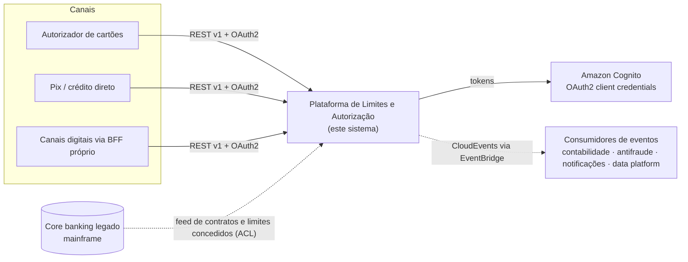
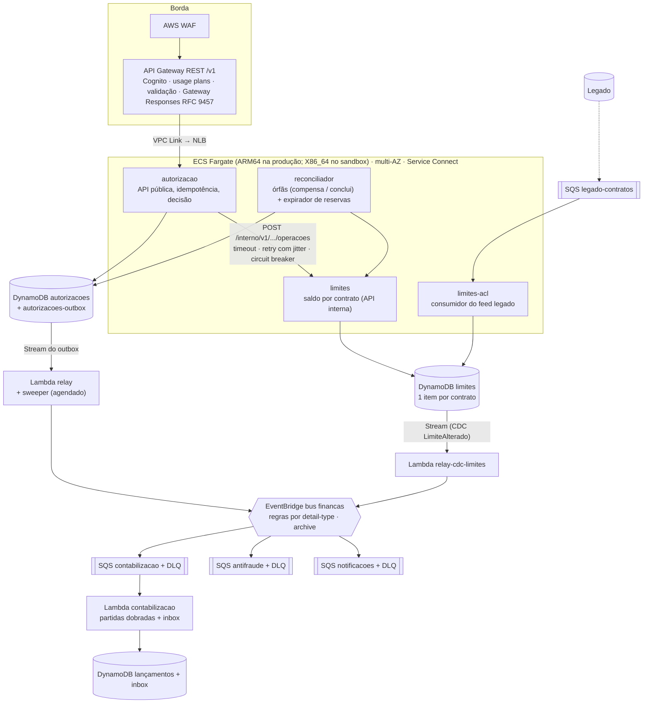
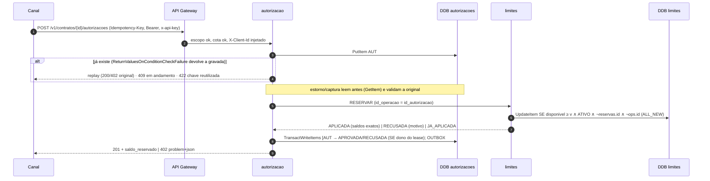

# Documento de arquitetura — Plataforma de Gestão de Limites e Autorização de Transações

> Para quem não vai ler os 20 ADRs: este documento é o mapa. Cada seção aponta o ADR com o porquê.

## 1. Resumo para stakeholders

- **O que faz.** Autoriza transações financeiras **em tempo real**, reservando ou consumindo o limite de crédito do contrato com **garantia de que o limite nunca é ultrapassado**, mesmo com centenas de pedidos simultâneos no mesmo contrato. Publica cada fato (autorização, recusa, estorno, mudança de limite) para contabilidade, antifraude, notificações e data platform.
- **Por que é confiável:**
  - **Repetir um pedido nunca cobra duas vezes:** idempotência ponta a ponta.
  - **Nenhum evento se perde ou é inventado:** outbox na mesma escrita do estado.
  - **Se um componente cai no meio, nada fica pela metade:** retomada pela mesma chave ou compensação automática.
- **O que foi provado:**

  | Prova | Onde |
  |---|---|
  | 100 reservas simultâneas de R$ 100 num limite de R$ 1.000 → **exatamente 10 aprovadas e 90 recusadas**, saldo final zero | Testes (memória e DynamoDB) e demo HTTP ponta a ponta |
  | Invariantes do saldo verificadas para **qualquer** sequência de operações | Testes property-based |
  | Desempenho | **Medido** na AWS real até 600 rps com 5.000 contratos e **extrapolado** para 5.000 TPS (`docs/capacidade.md` seções 3 a 5). Os 5.000 TPS **não foram executados** |

- **Principais riscos aceitos:**
  - limite concedido eventualmente consistente com o legado (segundos);
  - DR com RPO de segundos (não existe consistência forte multi-região a partir de São Paulo);
  - teto de ~8 operações/s **sustentadas por contrato** no item único (a guarda de idempotência mora no item), com alarme e evolução desenhada (ADR-0016).

## 2. Contexto (C4 nível 1)

Diagrama: [01-contexto.svg](diagramas/01-contexto.svg).

## 3. Containers (C4 nível 2)

Diagrama: [02-containers.svg](diagramas/02-containers.svg).

## 4. Fluxo síncrono de uma autorização

Diagrama: [03-sequencia-autorizacao.svg](diagramas/03-sequencia-autorizacao.svg).

**Pontos de falha e o que acontece:**

| Falha | Comportamento | ADR |
|---|---|---|
| `limites` lento ou fora | Timeout curto → retry com jitter → circuit breaker → **503 + Retry-After**; a autorização fica retomável | 0013 |
| Processo morre após reservar e antes de concluir | Retry do canal (mesma chave) **retoma** e o limite responde JA_APLICADA; sem retry, o **reconciliador compensa** | 0006 |
| Timeout com escrita aplicada no DynamoDB | O retry falha na guarda `ops.id` → JA_APLICADA, nunca debita duas vezes | 0005 |
| Sobrecarga | Load shedding → 503; usage plan e WAF → 429 | 0010, 0013 |
| Captura, estorno e expiração do mesmo hold ao mesmo tempo | O hold no `limites` é o árbitro: o primeiro que o remove vence; os outros → 409 | 0020 |
| Órfã além de 4 min (prazo de reaplicação) | DEBITO/CREDITO/ESTORNO/captura: 409 `conflito-de-estado` sem `Retry-After` e `RECONCILIACAO_MANUAL` na fila humana `RM#` (runbook R7); RESERVA ainda compensa (o hold é guarda durável) | 0006 |

## 5. Eventos

- **Caminho:** outbox (mesma escrita do estado) → Stream → relay → bus `financas` → regras → filas com DLQ → consumidores idempotentes (inbox).
- **Formato:** CloudEvents 1.0 estruturado em `detail`, com o `id` estável para dedup e `versao_limite` para ordem por contrato.
- **Contratos:** `contracts/events/` (JSON Schema + exemplos), verificados por teste no produtor e por gate de compatibilidade na CI.
- **ADRs:** 0007, 0008, 0009.
- **Diagrama:** [04-fluxo-de-eventos.svg](diagramas/04-fluxo-de-eventos.svg).

## 6. Domínio

Ver `docs/dominio/` (linguagem ubíqua e agregados) e o ADR-0002. Os agregados:

- **Limite**, com as invariantes I1–I6 em `limites/domain/limite.py`;
- **Autorização**, com máquina de estados e eventos em `autorizacao/domain/autorizacao.py`;
- **Lançamento**, com partidas dobradas em `contabilizacao/domain/lancamento.py`.

## 7. Implantação (sandbox AWS, `infra/terraform`)

- **Região e conta:** sa-east-1, conta dedicada `desafio-zup` numa OU Sandbox com SCP de regiões.
- **Rede:** VPC com 2 AZs. **Sandbox sem NAT**: subnets públicas sem ingress da internet, por custo, com VPC endpoints gateway para DynamoDB e S3; produção usa subnets privadas e endpoints de interface.
- **Componentes:**
  - ECS Fargate com Service Connect: ARM64 é o alvo de produção (ADR-0004); o sandbox implantado pela esteira roda X86_64, porque o runner do GitHub é x86;
  - NLB interno + VPC Link;
  - DynamoDB on-demand com PITR;
  - EventBridge, SQS e Lambdas arm64;
  - Cognito, WAF;
  - CloudWatch: dashboard e alarmes.
- **Diagrama:** [05-implantacao-aws.svg](diagramas/05-implantacao-aws.svg).
- **State:** S3 com KMS e lock nativo.
- **Deploy:** pela esteira do GitHub Actions (OIDC, sem chave de longa duração) a cada push na `main`, ou `make deploy`, que exige `CONFIRMO:` e confere o ID da conta.
- **Inventário completo** (162 recursos do sandbox, ambiente `esteira`, bootstrap da conta, custo e desvios): `docs/operacao/infraestrutura.md`.

## 8. Qualidade

- **Atributos de qualidade** pelos seis pilares do Well-Architected: `docs/arquitetura/well-architected.md`.
- **Gates da CI:**
  - ruff;
  - mypy strict;
  - import-linter (arquitetura);
  - pytest (unit, property-based, contrato, integração);
  - Spectral, oasdiff e compatibilidade de schemas;
  - terraform fmt, validate e test;
  - Checkov e Trivy.
