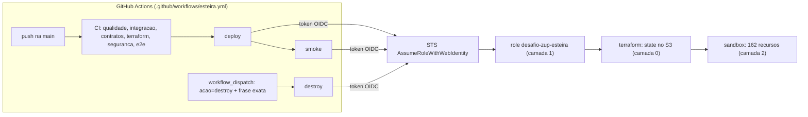

# Infraestrutura na AWS — inventário, bootstrap e esteira

> **Fonte de verdade:** o state do Terraform. Este inventário foi conferido em **20/10/2026** contra `terraform state list`, `terraform show -json` e as APIs da AWS, com o sandbox implantado pela esteira a partir do commit `977c13a`. Cada push na `main` troca só a tag das imagens (`git-<sha12>`) e as revisões das task definitions. As referências a arquivos valem para a versão do repositório que contém este documento.
> **Convenção:** ID de conta, ARNs com conta e segredos não aparecem aqui. Onde o nome real contém a conta, está escrito `<conta>`.
> Decisões e porquês ficam nos ADRs; este documento diz **o que existe, onde e com que configuração**.

## 1. As três camadas

| Camada | Como nasce | Quem aplica | State | Sobrevive ao destroy do sandbox? |
|---|---|---|---|---|
| **0. Bootstrap da conta** | Manual, uma vez por conta (seção 2) | Administrador da Organization | — | Sim |
| **1. Ambiente `esteira`** (`infra/terraform/environments/esteira`, 5 recursos) | Terraform | Administrador, uma vez; **nunca** a própria esteira | `esteira/terraform.tfstate` | Sim |
| **2. Ambiente `sandbox`** (`infra/terraform/environments/sandbox`, 162 recursos) | Terraform | Esteira (push na `main`) ou `make deploy` | `sandbox/terraform.tfstate` | Não: é o que o destroy remove |

Além delas, a AWS cria sozinha alguns recursos ao primeiro uso de certos serviços (seção 5). O Terraform não os gerencia.



## 2. Camada 0 — bootstrap da conta

Feito à mão em 19/10/2026. Configuração conferida pela API em 20/10/2026.

| Item | Configuração | Para quê |
|---|---|---|
| **Organization** (na conta de gestão) | Feature set `ALL`; SCP habilitada na raiz | Isolar o desafio de outras cargas e permitir guardrail por SCP |
| **OU `Sandbox`** | Contém só a conta `desafio-zup`. SCPs anexadas: `FullAWSAccess` e `sandbox-guardrails` | — |
| **SCP `sandbox-guardrails`** | (1) `Deny` de tudo fora de `sa-east-1` e `us-east-1` (`aws:RequestedRegion`), exceto o que está no `NotAction`. A lista inclui os serviços globais (IAM, STS, Organizations, Budgets, Cost Explorer, Route 53, CloudFront, Support…), mas também serviços **regionais**: KMS, Config, ACM, WAF/WAFv2, Direct Connect, Service Quotas, Well-Architected e 3 `ec2:Describe*`. Nesses, a trava de região **não vale**. (2) `Deny` de `organizations:LeaveOrganization` | Trava de região (parcial, ver seção 9) e impede que a conta saia da Organization |
| **Conta-membro `desafio-zup`** | Acesso administrativo pela `OrganizationAccountAccessRole`, criada pela Organization junto com a conta | Conta dedicada: o destroy não arrisca nada além do desafio |
| **Bucket de state `desafio-zup-tfstate-<conta>`** (sa-east-1) | Versionado; SSE-KMS com a chave gerenciada `aws/s3` e Bucket Key; Block Public Access nas 4 opções; Object Ownership `BucketOwnerEnforced`; policy `SomenteTLS` (nega `s3:*` com `aws:SecureTransport=false`) | State dos dois ambientes. Lock nativo do S3 (`use_lockfile = true`), sem tabela DynamoDB de lock |
| **CloudTrail `desafio-zup-trail`** (região de origem sa-east-1) | Multi-região; eventos de serviços globais; validação de integridade dos arquivos; eventos de gerenciamento de leitura e escrita; **sem** eventos de dados, sem chave KMS própria, sem envio ao CloudWatch Logs | Trilha de auditoria (ADR-0017) |
| **Bucket `desafio-zup-cloudtrail-<conta>`** (sa-east-1) | Versionado; SSE-S3; Object Lock em modo `GOVERNANCE` por 1 dia; lifecycle `expira-30d` (objetos em 30 dias, versões não correntes em 1 dia); Block Public Access; policy com TLS obrigatório e escrita só do trail (`aws:SourceArn`) | WORM com retenção curta, para demonstrar o mecanismo (ADR-0017). Na produção, o ADR-0017 define Object Lock em modo `COMPLIANCE` por 10 anos para a trilha de eventos (archive e Firehose → S3). Para o CloudTrail, `docs/compliance.md` liga a trilha à Res. ANPD 15/2024 (registro de incidentes por 5 anos) |
| **Budget `desafio-zup-mensal`** | Custo mensal de US$ 30. Alertas por e-mail: gasto real acima de 50%, 80% e 100% e previsão acima de 100%. **Sem budget action** | **Alerta, não teto**: nada é bloqueado ou desligado. Com o sandbox no ar (~US$ 7/dia, seção 7), os US$ 30 acabam em ~4 dias. Quem encerra o gasto é o destroy |
| **Quotas** (sa-east-1) | EventBridge `PutEvents`: aumento para 6.000 TPS aprovado. EventBridge `Invocations`: aumento para 20.000 TPS aprovado. Lambda, execuções concorrentes: 1.000 em vigor (o pedido para 1.000 foi encerrado como caso de suporte). Fargate On-Demand vCPU: 140 (valor da conta, sem pedido). Pedidos de 19/10/2026 | Dimensionamento do pico de 5.000 TPS (ADR-0001, 0004 e 0009) |

**Para reproduzir em outra conta**, nesta ordem:

1. Criar uma conta dedicada e, se houver Organization, anexar uma SCP de regiões equivalente.
2. Configurar no AWS CLI um profile `desafio-zup` com acesso administrativo à conta (por exemplo, assumindo a `OrganizationAccountAccessRole`). O `Makefile` e os comandos deste documento usam esse nome de profile.
3. Criar o bucket de state `desafio-zup-tfstate-<conta>` em sa-east-1 com a configuração da tabela. O nome é fixo no `Makefile` e na esteira: `-backend-config="bucket=desafio-zup-tfstate-<conta>"`.
4. Criar o budget e, para trilha de auditoria, o trail e o bucket com Object Lock. A stack não depende deles.
5. Pedir as quotas, se a carga for passar de algumas centenas de TPS.
6. Aplicar a camada 1 (seção 3) e cadastrar os dois segredos do repositório.
7. Fazer push na `main`.

## 3. Camada 1 — ambiente `esteira` (5 recursos)

| Recurso Terraform | Nome na AWS | Configuração |
|---|---|---|
| `aws_iam_openid_connect_provider.github` | `token.actions.githubusercontent.com` | Audiência `sts.amazonaws.com`. O STS valida a assinatura pelo JWKS do emissor |
| `aws_iam_role.esteira` | `desafio-zup-esteira` | Só `sts:AssumeRoleWithWebIdentity`, com `aud = sts.amazonaws.com` e `sub` **exato** `repo:giovanedms@194153057/desafio-zup@1427358154:ref:refs/heads/main`. Sessão de até 1 h |
| `aws_iam_role_policy_attachment.power_user` | — | `PowerUserAccess` (versão v12, de 12/02/2026): tudo menos IAM, Organizations e Account, **exceto 9 ações liberadas dentro deles**: `iam:CreateServiceLinkedRole`, `iam:DeleteServiceLinkedRole`, `iam:ListRoles`, `organizations:DescribeOrganization`, `organizations:DescribeEffectivePolicy`, `account:GetAccountInformation`, `account:GetGovCloudAccountInformation`, `account:GetPrimaryEmail` e `account:ListRegions`. Service-linked roles (seção 5) ficam fora do boundary. Desvio consciente, ver seção 9 |
| `aws_iam_role_policy.iam_delegada` | `iam-com-boundary-obrigatorio` | IAM delegada (ver lista abaixo) |
| `aws_iam_policy.limite` | `desafio-zup-limite-de-permissoes` | **Permissions boundary** de toda role criada pela stack (ver lista abaixo) |

**Por que o `sub` tem IDs.** Para este repositório, o GitHub emite o claim com o ID imutável do dono e do repositório (`dono@id/repo@id`). O formato só com nomes foi recusado no primeiro deploy: o evento `AssumeRoleWithWebIdentity` negado, no CloudTrail, mostrou o `sub` real. Um repositório recriado com o mesmo nome tem outro ID e **não** assume a role. Forks e pull requests também não, porque o `ref` exigido é `refs/heads/main`.

**IAM delegada (`iam-com-boundary-obrigatorio`)**, em 7 statements:
- **Criar e alterar role:** `CreateRole`, `PutRolePermissionsBoundary`, `PutRolePolicy`, `DeleteRolePolicy`, `AttachRolePolicy` e `DetachRolePolicy`, só com `iam:PermissionsBoundary` igual ao boundary.
- **Manter roles:** `DeleteRole`, `TagRole`, `UntagRole`, `UpdateAssumeRolePolicy`, `UpdateRole` e `UpdateRoleDescription`, só em roles com a tag `project=desafio-autorizacao`.
- **Etiquetar role nova:** `TagRole` quando o pedido traz a tag `project=desafio-autorizacao`.
- **`iam:PassRole`:** só para `ecs-tasks`, `lambda`, `apigateway` e `scheduler`.
- **Leitura:** `iam:Get*` e `iam:List*`.
- **`Deny iam:*`** na própria role, no boundary, na `OrganizationAccountAccessRole` e no provedor OIDC.
- **`Deny iam:DeleteRolePermissionsBoundary`** em tudo.

**Boundary (`desafio-zup-limite-de-permissoes`)**: o teto de toda role da stack. Os recursos são da conta em sa-east-1, exceto as 4 ações sem nível de recurso do último item. Statements:
- **Dados:** ações de item, consulta e Stream do DynamoDB em `table/*`.
- **Mensageria:** `sqs:SendMessage`, `ReceiveMessage`, `DeleteMessage`, `ChangeMessageVisibility`, `GetQueueAttributes` e `GetQueueUrl`.
- **Eventos:** `events:PutEvents` em `event-bus/*`.
- **Lambdas:** `lambda:InvokeFunction` nas funções da conta.
- **Logs:** `logs:CreateLogGroup`, `CreateLogStream` e `PutLogEvents` (escrita), e `DescribeLogGroups`, `DescribeLogStreams`, `FilterLogEvents` e `GetLogEvents` (leitura).
- **Imagens:** pull no ECR.
- **Sem nível de recurso:** `ecr:GetAuthorizationToken`, `xray:PutTraceSegments`, `xray:PutTelemetryRecords` e `cloudwatch:PutMetricData`.

A permissão efetiva de cada role é a **interseção** da política dela com o boundary.

**Segredos do repositório GitHub:** `AWS_ROLE_ARN`, o ARN da role, que é o output `role_de_deploy_arn`, e `AWS_ACCOUNT_ID`. Nenhuma chave de acesso de longa duração. O ambiente também exporta `limite_de_permissoes_arn`, o ARN do boundary.

**Aplicar ou alterar (administrador, fora da esteira):**

```bash
# Init com o bucket de state da conta (backend parcial) e apply com o profile administrativo da conta
AWS_PROFILE=desafio-zup terraform -chdir=infra/terraform/environments/esteira init -backend-config="bucket=desafio-zup-tfstate-<conta>"
AWS_PROFILE=desafio-zup terraform -chdir=infra/terraform/environments/esteira apply -var account_id=<conta>
```

As variáveis `repositorio_github`, `id_dono_github`, `id_repositorio_github` e `branch_de_deploy` têm default para este repositório. Em um fork, os IDs mudam e precisam ser passados.

## 4. Camada 2 — ambiente `sandbox` (162 recursos)

| Módulo | Recursos | Conteúdo |
|---|---:|---|
| raiz (`main.tf`) | 10 | Cluster ECS, namespace do Service Connect, 4 task roles e as 4 políticas delas |
| `rede` | 15 | VPC, subnets, rotas, security groups, 2 VPC endpoints gateway |
| `api` | 30 | API Gateway REST, Cognito, WAF, NLB, VPC Link, logs do gateway |
| `ecs_servico` × 4 (`autorizacao`, `limites`, `limites_acl`, `reconciliador`) | 28 (7 cada) | Service, task definition, log group, role de execução e a política dela, alvo e política de autoscaling |
| `dados` | 7 | 5 tabelas DynamoDB e Contributor Insights em 2 delas |
| `ecr` | 6 | 3 repositórios e as lifecycle policies |
| `eventos` | 25 | Bus, archive, 4 regras, 4 targets, 8 filas SQS, 3 queue policies, 4 redrive-allow |
| `lambdas` | 22 | 4 funções, 3 event source mappings, 1 schedule, 4 roles e 4 políticas, 2 DLQs, 4 log groups |
| `observabilidade` | 19 | 13 alarmes, 4 metric filters, 1 dashboard, 1 regra de Contributor Insights |
| **Total** | **162** | `terraform state list` mostra 163 linhas: a 163ª é o data source `module.api.data.aws_region.atual` |

**Tags.** O `default_tags` do provider aplica `environment=sandbox`, `team=plataforma-financas`, `managed-by=terraform` e `project=desafio-autorizacao`. Ficam **sem tag 55 recursos de 22 tipos**, todos de tipos que não têm argumento de tags no provider. Pelo state:
- **IAM:** `aws_iam_role_policy` (12), `aws_iam_role_policy_attachment` (1).
- **API Gateway:** `aws_api_gateway_account` (1), `aws_api_gateway_deployment` (1), `aws_api_gateway_method_settings` (1), `aws_api_gateway_usage_plan_key` (3).
- **Cognito:** `aws_cognito_user_pool_client` (3), `aws_cognito_user_pool_domain` (1), `aws_cognito_resource_server` (1).
- **Eventos e filas:** `aws_cloudwatch_event_archive` (1), `aws_cloudwatch_event_target` (4), `aws_sqs_queue_policy` (3), `aws_sqs_queue_redrive_allow_policy` (4), `aws_scheduler_schedule` (1).
- **Observabilidade:** `aws_cloudwatch_dashboard` (1), `aws_cloudwatch_log_metric_filter` (4), `aws_dynamodb_contributor_insights` (2).
- **Rede:** `aws_route` (1), `aws_route_table_association` (2).
- **Demais:** `aws_ecr_lifecycle_policy` (3), `aws_appautoscaling_policy` (4), `aws_wafv2_web_acl_association` (1).

Os outros 107 têm as 4 tags. O ambiente `esteira` usa as mesmas.

### 4.1 Rede (`modules/rede`)

| Recurso | Configuração |
|---|---|
| VPC `desafio` | `10.40.0.0/16`, DNS hostnames e DNS support ligados |
| Subnets `desafio-publica-sa-east-1a` e `desafio-publica-sa-east-1c` | `10.40.0.0/24` e `10.40.1.0/24`. `map_public_ip_on_launch = false`: o IP público vem do service ECS (`assign_public_ip = true`) |
| Internet gateway, route table `desafio-publica` | Rota `0.0.0.0/0` para o IGW, associada às 2 subnets |
| Security group default `desafio-default-fechado` | Sem regras (fechado) |
| Security group `desafio-tasks-<sufixo>` (tag `Name` = `desafio-tasks`; o nome usa `name_prefix`) | Entrada: TCP 8080 de `10.40.0.0/16` (NLB e Service Connect). Saída: TCP 443 para `0.0.0.0/0` (APIs AWS) e TCP 8080 para `10.40.0.0/16` |
| VPC endpoints **gateway** `com.amazonaws.sa-east-1.dynamodb` e `com.amazonaws.sa-east-1.s3` | Na route table pública, com a política padrão (acesso total) |

**Caminho do tráfego.** DynamoDB e S3 saem pelos endpoints gateway e não passam pela internet. As camadas das imagens do ECR são servidas pelo S3. As demais APIs (ECR API, CloudWatch Logs, SQS do `limites-acl`) saem pelo internet gateway na porta 443, com o IP público da task. **Não há NAT gateway.**

### 4.2 Borda (`modules/api`)

| Recurso | Nome | Configuração |
|---|---|---|
| REST API | `desafio-autorizacao` | Regional. O body importado parte do contrato `contracts/openapi/autorizacao-v1.yaml`, que traz as 2 rotas (`/v1/contratos/{id_contrato}/autorizacoes` e `.../{id_autorizacao}`) e declara só o esquema `oauth2`. O módulo (`modules/api/main.tf`, `local.especificacao`) acrescenta: a integração de cada rota com o VPC Link, o validador `completo` (body e parâmetros), os esquemas `cognito` (authorizer do user pool) e `api_key` (header `x-api-key`) e as **9 gateway responses** em RFC 9457 (`ACCESS_DENIED`, `BAD_REQUEST_BODY`, `BAD_REQUEST_PARAMETERS`, `DEFAULT_4XX`, `DEFAULT_5XX`, `INTEGRATION_TIMEOUT`, `QUOTA_EXCEEDED`, `THROTTLED` e `UNAUTHORIZED`). As respostas ficam dentro do body porque, como resources separados, eram apagadas a cada reimportação (achado no deploy 1.0.1) |
| Deployment e stage | `v1` | Redeploy quando muda o hash do body. X-Ray ligado. Access log JSON em `/aws/apigateway/desafio-autorizacao-v1`. Execution log nível `ERROR` em `API-Gateway-Execution-Logs_<api-id>/v1`. Métricas por método. Sem cache |
| Configuração da conta (`aws_api_gateway_account`) | — | Aponta para a role `desafio-autorizacao-apigw-cloudwatch` (`AmazonAPIGatewayPushToCloudWatchLogs`). É configuração da conta e da região, não da API |
| VPC Link | `desafio-autorizacao-nlb` | Integração do REST (v1) com o NLB |
| NLB | `desafio-autorizacao-nlb` | Interno, cross-zone, sem proteção contra exclusão (sandbox). Listener TCP 80 para o target group `desafio-autorizacao-tg` (TCP 8080, alvo `ip`). Health check HTTP `/saude` a cada 10 s (2 sucessos ou 2 falhas). Deregistration de 30 s |
| Cognito user pool | `desafio-autorizacao-canais` | Só administrador cria usuário. Domínio `desafio-autorizacao-<conta>`. Resource server `autorizacoes` com escopos `read` e `write` |
| Cognito app clients | `canal-app`, `canal-pos`, `canal-carga` | Fluxo `client_credentials`, com segredo, escopos `autorizacoes/read` e `autorizacoes/write`. Validade do token: padrão do Cognito |
| API keys e usage plans | — | `canal-app` → `plano-restrito` (5 rps, burst 10, 1.000/dia). `canal-pos` → `plano-padrao` (200 rps, burst 400, 1 milhão/dia). `canal-carga` → `plano-carga` (6.000 rps, burst 5.000, 50 milhões/dia). A AWS aplica o throttling de usage plan em regime de melhor esforço (ADR-0010). O smoke manda 30 requisições sequenciais pelo `canal-app`, abaixo do balde, e não prova o 429 |
| WAF | `desafio-autorizacao-waf` | Regional, associado ao stage. Regra 1, `limite-por-ip`: rate-based de 2.000 requisições por IP em 5 min, bloqueia. Regra 2, `aws-common`: `AWSManagedRulesCommonRuleSet`. Ação padrão `allow`. Métricas e amostragem ligadas |

Outputs do ambiente: `invoke_url`, `token_endpoint`, `cognito_client_ids`, `ecr_urls`, `dashboard`, e os **sensíveis** `cognito_client_secrets` e `api_keys`. Os scripts `tests/e2e/aws.py` e `tests/load/aws_k6.py` leem esses outputs e nunca os imprimem.

### 4.3 Computação síncrona (raiz e `modules/ecs_servico`)

Cluster `desafio` com Container Insights ligado. Namespace HTTP `desafio.local` para o Service Connect.

| Service | Imagem e comando | CPU/memória | Tasks (autoscaling) | Root FS | Health check | Service Connect | Variáveis de ambiente |
|---|---|---|---|---|---|---|---|
| `autorizacao` | `desafio-zup/autorizacao` | 512 / 1024 MiB | 2 (2–20) | Só leitura | HTTP `/saude` | Cliente | `AWS_REGION`, `MAX_EM_VOO` (32, `var.max_em_voo`), `TABELA_AUTORIZACOES`, `TABELA_OUTBOX`, `URL_LIMITES` |
| `limites` | `desafio-zup/limites` | 512 / 1024 MiB | 2 (2–20) | Só leitura | HTTP `/saude` | **Servidor** `limites:8080` | `AWS_REGION`, `TABELA_LIMITES` |
| `limites-acl` | Imagem do `limites`, `python -m limites.adapters.inbound.legado.consumidor` | 256 / 512 MiB | 1 (1–1) | Gravável | Heartbeat em `/tmp` < 30 s | — | `ACL_MODO_AWS`, `AWS_REGION`, `FILA_LEGADO`, `TABELA_LIMITES` |
| `reconciliador` | Imagem da `autorizacao`, `python -m autorizacao.adapters.inbound.reconciliador` | 256 / 512 MiB | 1 (1–1) | Gravável | Heartbeat em `/tmp` < 90 s | Cliente | `AWS_REGION`, `TABELA_AUTORIZACOES`, `TABELA_OUTBOX`, `URL_LIMITES` |

Comum aos 4:
- Fargate `LATEST`, `awsvpc`, arquitetura **X86_64** no sandbox (seção 6) e usuário `10001:10001`.
- Subnets públicas com IP público e o security group `desafio-tasks`.
- Circuit breaker de deploy com rollback, mínimo saudável de 100% e máximo de 200%. ECS Exec desligado.
- Target tracking de CPU a 60%, com cooldown de 60 s para subir e 300 s para descer. Em `limites-acl` e `reconciliador`, mínimo = máximo = 1, então a política não age. É a configuração do sandbox, não um limite do desenho:
  - no `limites-acl`, a aplicação converge para a maior versão em qualquer ordem e com repetição, por compare-and-set na versão do registro (ADR-0014). Mais consumidores na mesma fila só reordenariam e repetiriam entregas, que é o caso que esse mecanismo já cobre. Isso é uma inferência deste documento: o ADR não trata de múltiplos consumidores, e não há teste com mais de um;
  - no `reconciliador`, o ADR-0020 registra que várias tasks são seguras, mas repetiriam trabalho. O certo, quando o volume pedir, é dividir os 10 shards do índice entre as tasks.
- Imagens com a tag `git-<sha12>` do commit.

Cada módulo `ecs_servico` também cria o log group `/ecs/<nome>` (7 dias) e a role de execução `<nome>-ecs-execucao`. A role de execução faz pull só do repositório da imagem que o service roda e escreve só no próprio log group. No `limites-acl`, o repositório é `desafio-zup/limites`; no `reconciliador`, `desafio-zup/autorizacao`. O `ecr:GetAuthorizationToken` fica em `*`, porque a API não aceita recurso.

**Task roles** (raiz, todas com o boundary):

| Role | Permissões |
|---|---|
| `desafio-task-autorizacao` | `autorizacoes`: `GetItem`, `PutItem`, `UpdateItem`, `ConditionCheckItem`. `autorizacoes-outbox`: `PutItem` |
| `desafio-task-limites` | `limites`: `GetItem`, `PutItem`, `UpdateItem` |
| `desafio-task-limites-acl` | Fila `legado-contratos`: `ReceiveMessage`, `DeleteMessage`, `GetQueueAttributes`, `GetQueueUrl`. `limites`: `GetItem`, `PutItem`, `UpdateItem` |
| `desafio-task-reconciliador` | `Query` nos índices `gsi_orfas` e `gsi_vencimentos`. `autorizacoes`: `GetItem`, `PutItem`, `UpdateItem`. `autorizacoes-outbox`: `PutItem` |

O `run "task_roles_menor_privilegio"` em `infra/terraform/tests/sandbox.tftest.hcl` falha nestes casos:
- alguma das 4 políticas usa `*`, `dynamodb:*` ou (em `limites-acl` e `reconciliador`) `sqs:*`;
- `autorizacao`, `limites` ou `reconciliador` apontam para recurso que não é tabela ou índice DynamoDB;
- o `reconciliador` não alcança os dois índices;
- o `limites-acl` toca algo além da fila do legado e da tabela `limites`;
- alguma das 4 task roles está sem o boundary.

### 4.4 Dados (`modules/dados`)

| Tabela | Chave | Índices | Stream (consumidor) | TTL |
|---|---|---|---|---|
| `limites` | `id_contrato` | — | `NEW_AND_OLD_IMAGES` (Lambda `desafio-relay-cdc-limites`, só `MODIFY`) | — |
| `autorizacoes` | `pk` | `gsi_orfas` (`orfa_shard`, `orfa_lease_ms`) e `gsi_vencimentos` (`venc_shard`, `venc_ms`), ambos esparsos, projeção `ALL` | — | `ttl` |
| `autorizacoes-outbox` | `pk` | — | `NEW_IMAGE` (Lambda `desafio-relay`) | `ttl` |
| `contabilizacao-lancamentos` | `pk` | — | — | — |
| `contabilizacao-inbox` | `pk` | — | — | `ttl` |

Comum às 5:
- On-demand e classe `STANDARD`.
- PITR com janela de 35 dias.
- SSE-KMS com a chave gerenciada pela AWS (`aws/dynamodb`).
- Proteção contra exclusão desligada (`var.deletion_protection = false`, para o destroy funcionar).

Contributor Insights ligado em `limites` e `autorizacoes`.

### 4.5 Eventos (`modules/eventos`)

Bus `financas` e archive `financas-archive`, que guarda todos os eventos do bus por 30 dias.

| Regra | Filtro (`source` / `detail-type`) | Fila |
|---|---|---|
| `para-antifraude` | `financas.autorizacao` / `TransacaoAutorizada`, `TransacaoRecusada` | `antifraude` |
| `para-contabilizacao` | `financas.autorizacao` / `TransacaoAutorizada`, `TransacaoEstornada`, `ReservaExpirada`, `ReservaCapturada` | `contabilizacao` |
| `para-notificacoes` | `financas.autorizacao` / `TransacaoAutorizada`, `TransacaoRecusada`, `TransacaoEstornada` | `notificacoes` |
| `limite-alterado-para-notificacoes` | `financas.limites` / `LimiteAlterado` | `notificacoes` |

- `TransacaoCompensada` e `TransacaoEmReconciliacaoManual` **não têm regra**: vão só para o archive. A fila humana é acompanhada pelo alarme `reconciliador-encaminhadas` (runbook R7).
- Os targets **não têm DLQ nem política de retry própria**. Vale o padrão do EventBridge: novas tentativas por até 24 h e no máximo 185 vezes. Ver seção 9.
- A queue policy de cada fila aceita `sqs:SendMessage` só da(s) regra(s) dela (`aws:SourceArn`).

| Fila | Visibilidade | Retenção | Redrive | Consumidor no sandbox |
|---|---|---|---|---|
| `contabilizacao` | 180 s | 14 dias | 5 recebimentos → `contabilizacao-dlq` | Lambda `desafio-contabilizacao` |
| `antifraude` | 180 s | 14 dias | 5 → `antifraude-dlq` | Nenhum: representa o sistema a jusante. As mensagens expiram em 14 dias |
| `notificacoes` | 180 s | 14 dias | 5 → `notificacoes-dlq` | Nenhum: idem |
| `legado-contratos` | 180 s | 14 dias | 5 → `legado-contratos-dlq` | Service `limites-acl`. O produtor é o core legado (no sandbox, `tests/e2e/aws.py contratos`) |
| As 4 DLQs | 30 s | 14 dias | Redrive-allow `byQueue`, só da fila de origem | — |

Todas as filas usam SSE-SQS.

### 4.6 Assíncrono (`modules/lambdas`)

| Função | Handler | Gatilho | Role |
|---|---|---|---|
| `desafio-relay` | `relay.lambda_handler.handler` | Stream de `autorizacoes-outbox` | `desafio-relay-role` |
| `desafio-sweeper` | `relay.sweeper.handler_agendado` | EventBridge Scheduler `desafio-sweeper-5min`, `rate(5 minutes)`, pela role `desafio-sweeper-scheduler` | `desafio-relay-role` (a mesma do relay) |
| `desafio-relay-cdc-limites` | `relay.lambda_handler.handler_cdc_limites` | Stream de `limites` com filtro `eventName = MODIFY`; publica `LimiteAlterado` | `desafio-relay-cdc-limites-role` |
| `desafio-contabilizacao` | `contabilizacao.adapters.inbound.lambda_sqs.handler` | Fila `contabilizacao`: lote de 10, concorrência máxima de 20, falha parcial de lote | `desafio-contabilizacao-role` |

- **Comum:** arm64, Python 3.13, pacote zip gerado por `make pacotes` em `infra/terraform/build/`, 256 MB, timeout de 30 s (o sweeper tem 60 s), X-Ray `Active`, sem concorrência reservada e log group `/aws/lambda/<nome>` com 7 dias.
- **Gatilhos de Stream** (relay e CDC): lote de 100, posição `LATEST`, bisect em erro, 5 novas tentativas, `ReportBatchItemFailures`, sem limite de idade do registro (vale a retenção do Stream). Em falha, os registros vão para `relay-dlq` ou `relay-cdc-limites-dlq` (14 dias).

**Permissões das roles:**
- **Relay:** ler o Stream do outbox; `DeleteItem`, `BatchWriteItem` e `Scan` no outbox (o `Scan` é do sweeper); `PutEvents` no bus `financas`; DLQ; logs do relay e do sweeper; X-Ray.
- **CDC:** ler o Stream de `limites`; `PutEvents`; DLQ; logs; X-Ray.
- **Contabilização:** consumir a fila e ler e escrever nas duas tabelas dela; logs; X-Ray.
- **Scheduler:** `lambda:InvokeFunction` só no sweeper.

### 4.7 Imagens (`modules/ecr`)

Repositórios `desafio-zup/autorizacao`, `desafio-zup/limites` e `desafio-zup/relay`, com:
- tags **imutáveis** e scan no push;
- criptografia AES-256;
- `force_delete = true`, para o destroy apagar as imagens;
- lifecycle que mantém as 10 imagens mais recentes.

A esteira publica só `autorizacao` e `limites`. **O `desafio-zup/relay` fica vazio**: na AWS o relay roda como Lambda zip, e a imagem dele só é usada no ambiente local. Ver seção 9.

### 4.8 Observabilidade (`modules/observabilidade`)

Dashboard `desafio-autorizacao`. Log groups: 10, todos com retenção de 7 dias e criptografia padrão do CloudWatch Logs (4 de ECS, 4 de Lambda, 2 do API Gateway).

| Alarme (`desafio-autorizacao-…`) | Métrica | Dispara quando |
|---|---|---|
| `api-5xx-acima-de-1pct` | `100 * erros / FILL(total, 1)`, com `erros` = soma de `5XXError` e `total` = soma de `Count` do stage `v1` (5 min) | > 1% |
| `api-latencia-p99` | `Latency` p99 do stage `v1` (1 min) | > 150 ms em 3 de 5 pontos |
| `dlq-<fila>` (6: `antifraude-dlq`, `contabilizacao-dlq`, `notificacoes-dlq`, `legado-contratos-dlq`, `relay-dlq`, `relay-cdc-limites-dlq`) | `ApproximateNumberOfMessagesVisible` máximo (1 min) | > 0 |
| `relay-iterator-age` | `IteratorAge` máximo de `desafio-relay` (1 min) | > 60 s |
| `guarda-de-idempotencia` | `desafio-zup/limites OperacoesNaGuarda` máximo (5 min) | > 2.000 entradas |
| `reconciliador-encaminhadas` | `OrfasEncaminhadas` (logs com `orfa_ENCAMINHADA` ou `reserva_ENCAMINHADA`), soma em 5 min | ≥ 1 |
| `reconciliador-falhas` | `FalhasDoReconciliador` (`orfa_FALHOU` ou `reserva_FALHOU`), soma em 5 min | ≥ 6 |
| `reconciliador-hold_perdido` | `ReservasSemHold` (`reserva_PERDEU_O_HOLD`), soma em 15 min | ≥ 20 |

- **Metric filters (4):** os três do reconciliador, sobre `/ecs/reconciliador` (namespace `desafio-zup/autorizacao`), e o da guarda, sobre `/ecs/limites` (namespace `desafio-zup/limites`, valor `$.operacoes_na_guarda`).
- **Regra de Contributor Insights `desafio-autorizacao-guarda-por-contrato`:** em `/ecs/limites`, os contratos com mais `operacoes_na_guarda` (ADR-0016, runbook R8).
- Os 13 usam `treat_missing_data = notBreaching`: ausência de dado conta como OK. Fila vazia ou função sem invocação não dispara alarme.
- **Nenhum alarme tem ação** (`alarm_actions` vazio). No sandbox eles mudam de estado e aparecem no console e no dashboard, mas não avisam ninguém. Ver seção 9.

### 4.9 IAM do sandbox: 13 roles, 12 políticas inline e 1 attachment

| Role | Confia em | Onde |
|---|---|---|
| `desafio-task-autorizacao`, `desafio-task-limites`, `desafio-task-limites-acl`, `desafio-task-reconciliador` | `ecs-tasks.amazonaws.com` | raiz (4.3) |
| `autorizacao-ecs-execucao`, `limites-ecs-execucao`, `limites-acl-ecs-execucao`, `reconciliador-ecs-execucao` | `ecs-tasks.amazonaws.com` | `ecs_servico` (4.3) |
| `desafio-relay-role`, `desafio-relay-cdc-limites-role`, `desafio-contabilizacao-role` | `lambda.amazonaws.com` | `lambdas` (4.6) |
| `desafio-sweeper-scheduler` | `scheduler.amazonaws.com` | `lambdas` (4.6) |
| `desafio-autorizacao-apigw-cloudwatch` | `apigateway.amazonaws.com` | `api` (4.2). É a única com política gerenciada (o attachment) |

As 13 têm o permissions boundary `desafio-zup-limite-de-permissoes` (conferido no state). O `terraform test` cobre as 4 task roles. Nas outras 9, a garantia vale **só pelo caminho da esteira**: a IAM delegada recusa criar role sem o boundary. Pelo `make deploy`, com o profile administrativo, uma role sem boundary seria criada. O que impede isso hoje é o código, não a permissão: `local.limite_de_permissoes_arn` na raiz, repassado como `var.limite_de_permissoes_arn` aos módulos `ecs_servico`, `lambdas` e `api`. As trust policies não têm condição `aws:SourceAccount` ou `aws:SourceArn` (seção 9).

## 5. Recursos que a AWS cria fora do Terraform

| Recurso | Origem | Sai com o destroy? |
|---|---|---|
| Service-linked roles `AWSServiceRoleForECS`, `…ElasticLoadBalancing`, `…ApplicationAutoScaling_ECSService`, `…APIGateway`, `…DynamoDBCloudWatchContributorInsights` | Primeiro uso de cada serviço | Não. Sem custo |
| Service-linked roles `AWSServiceRoleForOrganizations`, `…ServiceQuotas`, `…Support`, `…TrustedAdvisor` | Criação da conta na Organization e pedidos de quota | Não. Sem custo |
| `OrganizationAccountAccessRole` | Organization, ao criar a conta | Não. É o acesso administrativo |
| 8 alarmes `TargetTracking-service/desafio/<serviço>-AlarmHigh-…` e `-AlarmLow-…` | Application Auto Scaling, um par por política de target tracking | Sim: o Application Auto Scaling apaga os alarmes junto com a política |
| Log group `/aws/ecs/containerinsights/desafio/performance` (retenção de 1 dia) | Container Insights do cluster | Não |
| Log group `/aws/apigateway/welcome` (sem retenção definida) | API Gateway, ao configurar a role de logs da conta | Não |
| VPC padrão `172.31.0.0/16` (sa-east-1 e us-east-1), event bus `default`, grupo X-Ray `Default` | Vêm com toda conta | Não. Não são usados |
| ENIs e IPs públicos das tasks | Fargate, por task | Sim: somem com as tasks |

## 6. Esteira (`.github/workflows/esteira.yml`)

**Disparos:**
- Todo `push` e `pull_request` roda o CI.
- O **deploy** roda só na `main`: em `push`, ou em `workflow_dispatch` com `acao=deploy`.
- O **destroy** roda só em `workflow_dispatch` na `main`, com `acao=destroy` e `confirmacao` exatamente igual a `CONFIRMO: destroy na conta desafio-zup`.
- Não há filtro de caminho: **todo commit na `main` faz deploy**, até um que só muda documentação. Como a tag da imagem é o commit, cada push gera imagens novas, novas revisões das task definitions e um rolling deploy dos 4 services. As 4 Lambdas também são republicadas: o `make pacotes` refaz os zips, e o hash muda. Medido no push de `e028986`, só com documentação: `4 added, 8 changed, 4 destroyed`. Foram 4 task definitions substituídas, 4 services e 4 funções.

| Job | O que barra | Ferramentas |
|---|---|---|
| `qualidade` | Lint, tipos, regras de arquitetura, testes unitários, de contrato e de propriedade | `make check` (ruff, mypy strict, import-linter, pytest) |
| `integracao` | Contratos das portas contra DynamoDB, SQS e EventBridge reais da LocalStack | LocalStack `4.14.0` fixada por digest, `make test-integracao` |
| `contratos` | Lint e estrutura do OpenAPI; exemplos de evento contra os JSON Schemas; em PR, compatibilidade com a base | Spectral, `openapi-spec-validator`, `jsonschema`, `scripts/compat_contratos.sh` |
| `terraform` | Formato, validação dos 2 ambientes e testes com `mock_provider` (nenhuma chamada à AWS) | Terraform `1.16.1`, `make tf-fmt tf-validate tf-test` |
| `seguranca` | Vulnerabilidade de dependências, segredo e misconfiguração (HIGH e CRITICAL), e política de IaC | Trivy (fs), Checkov |
| `e2e` | A stack local inteira e a demo de 7 seções, que sai com 1 em qualquer divergência | `make up`, `make demo` |
| `deploy` | Depende dos 6 jobs acima, na `main` | OIDC, ECR, buildx, Terraform |
| `smoke` | Borda do gateway (201, replay idêntico, 401 `problem+json`) e corrida de 100 reservas no DynamoDB real | `tests/e2e/aws.py borda` e `corrida` |
| `destroy` | Só manual, com a frase | `terraform destroy` |

**Passos do `deploy`, em ordem:**
1. Credenciais temporárias por OIDC (`configure-aws-credentials`, com o ID da conta mascarado no log).
2. Tag `git-<sha12>`.
3. `make pacotes` (zips das Lambdas).
4. `terraform init` com o bucket de state.
5. `apply -target=module.ecr`.
6. Login no ECR e `docker buildx build --platform linux/amd64` de `limites` e `autorizacao`, com cache do GitHub Actions. Uma tag que já existe é pulada.
7. `terraform plan -out=tfplan`. O resumo traz só os endereços dos recursos, sem valores.
8. `terraform apply tfplan`.
9. `aws ecs wait services-stable` nos 4 services.

**Por que X86_64 no sandbox.** O runner do GitHub é x86. Construir ARM64 exigiria emulação, e a esteira passa `TF_VAR_arquitetura_cpu=X86_64`. O default da variável é `ARM64`, o alvo de produção (ADR-0004). Na AWS, o ARM64 não foi medido (`docs/capacidade.md`).

**Garantias da esteira:**
- Actions fixadas por SHA de commit, com a tag no comentário.
- `permissions: contents: read` por padrão; `id-token: write` só em `deploy`, `smoke` e `destroy`.
- Grupo de concorrência `aws-sandbox` sem cancelamento: um apply nunca é interrompido no meio.
- Fora da `main`, execuções antigas do mesmo ref são canceladas.

**Caminho local, alternativo à esteira:** `make deploy` e `make destroy` (runbook R6).
- O alvo `_gate` exige `CONFIRMO="CONFIRMO: <ação> na conta desafio-zup"` e confere se `EXPECTED_ACCOUNT_ID` é a conta do profile `desafio-zup`.
- O padrão local é `TAG=1.0.4` e `ARQ=amd64`.
- O provider tem `allowed_account_ids = [var.account_id]`: um apply na conta errada falha antes de criar qualquer coisa.

## 7. Custo do sandbox no ar

Preços **de sa-east-1 na AWS Pricing API**, consultados em 20/10/2026. Os itens fixos rodam mesmo sem tráfego.

| Item | Conta | US$/dia |
|---|---|---:|
| Fargate x86 | (2×0,5 + 2×0,5 + 0,25 + 0,25) vCPU × US$ 0,0696 + (2×1 + 2×1 + 0,5 + 0,5) GB × US$ 0,0076, por hora | ~5,09 |
| NLB | US$ 0,034/h, mais US$ 0,00825 por LCU-hora (≈ 0 parado) | ~0,82 |
| IPv4 público | 6 tasks × US$ 0,005/h | ~0,72 |
| WAF | US$ 5/mês pelo web ACL + US$ 1/mês por regra (2), rateado por hora; mais US$ 0,60 por milhão de requisições | ~0,23 |
| Alarmes | ~22 métricas de alarme (13 da stack, o de 5xx com 2 métricas, + 8 do target tracking) × US$ 0,135/mês | ≤ 0,10 |
| **Fixo** | | **≈ 7** |

**Variável ou não quantificado aqui:**
- Container Insights.
- Ingestão de logs.
- Armazenamento das imagens do ECR (6 imagens) e do archive do EventBridge.
- PITR (por GB, com dados de demo).
- API Gateway, Cognito, WAF, DynamoDB, SQS, EventBridge e Lambda por uso.
- Execução do sweeper a cada 5 min.
- Contributor Insights.

O Cost Explorer da conta ainda mostrava US$ 0 em 20/10/2026, porque os dados de custo chegam com atraso. Conferir lá depois de 24 a 48 h. Custo da carga de pico: `docs/capacidade.md`.

**Depois do destroy** sobram as camadas 0 e 1 e os itens da seção 5. O custo vem quase todo de armazenamento no S3. O state é versionado e não tem lifecycle. Os logs do CloudTrail expiram em 30 dias. Os 2 log groups da seção 5 que sobrevivem custam valores desprezíveis. A primeira cópia dos eventos de gerenciamento do CloudTrail não é cobrada.

## 8. Como conferir este inventário

```bash
# Init com o bucket de state da conta (o backend é parcial) e contagem dos recursos gerenciados (162; o data source fica de fora)
AWS_PROFILE=desafio-zup terraform -chdir=infra/terraform/environments/sandbox init -backend-config="bucket=desafio-zup-tfstate-<conta>"
AWS_PROFILE=desafio-zup terraform -chdir=infra/terraform/environments/sandbox state list | grep -vc '\.data\.'
# Mesma conta para o ambiente da esteira (5)
AWS_PROFILE=desafio-zup terraform -chdir=infra/terraform/environments/esteira state list | grep -vc '\.data\.'
# Services, tasks em execução e revisão da task definition
aws ecs describe-services --profile desafio-zup --region sa-east-1 --cluster desafio \
  --services autorizacao limites limites-acl reconciliador \
  --query 'services[].[serviceName,runningCount,taskDefinition]' --output table
```

## 9. Desvios do sandbox em relação à produção

| Item | Sandbox | Produção | Onde está decidido |
|---|---|---|---|
| Rede das tasks | Subnets públicas com IP público e sem ingress da internet. Sem NAT. Endpoints gateway só para DynamoDB e S3 | Subnets privadas e endpoints de interface (ECR, Logs, STS, SQS, EventBridge) | ADR-0017, `docs/compliance.md` |
| Egress | TCP 443 para `0.0.0.0/0` | Prefix lists dos endpoints | `docs/compliance.md` |
| Arquitetura das tasks | X86_64 | ARM64 (Graviton), depois de medir | ADR-0004, seção 6 |
| Proteção contra exclusão | Desligada em tabelas e NLB (`var.deletion_protection`). O user pool usa o padrão do Cognito (`INACTIVE`). `force_delete` no ECR | Ligada | `var.deletion_protection` e módulos `api` e `ecr` |
| **Ação dos alarmes** | Nenhuma | SNS para o plantão, com runbook por alarme | Desvio registrado aqui |
| **DLQ nos targets do EventBridge** | Não há. Uma entrega que falha depois de 24 h ou 185 tentativas se perde, e o archive de 30 dias permite replay | DLQ por target, com alarme | Desvio registrado aqui |
| **Condição anti-confused-deputy nas trust policies** | Sem `aws:SourceAccount` ou `aws:SourceArn` | Com as duas condições | Desvio registrado aqui |
| **Repositório `desafio-zup/relay`** | Criado e vazio (default do módulo) | Remover do conjunto `repositorios` do módulo `ecr` | Desvio registrado aqui |
| **Trava de região da SCP** | O `NotAction` isenta também serviços regionais (KMS, Config, ACM, WAFv2, Direct Connect, Service Quotas…) | `NotAction` só com serviços globais de fato | Desvio registrado aqui |
| **Budget** | Só alerta por e-mail | Budget action ou automação que reduza ou pare a carga | Desvio registrado aqui |
| Retenção | Logs por 7 dias; archive de eventos por 30 dias; CloudTrail por 30 dias em `GOVERNANCE` (1 dia de lock) | Trilha de eventos: 10 anos em `COMPLIANCE` (Circular 3.978). CloudTrail: registro de incidentes por 5 anos (ANPD 15/2024) | ADR-0017, `docs/compliance.md` |
| Role da esteira | `PowerUserAccess` + IAM delegada com boundary. A `PowerUserAccess` também cria e apaga service-linked roles | Política gerada pelo IAM Access Analyzer a partir do CloudTrail | `docs/compliance.md` |
| mTLS leste-oeste | Desligado | TLS do Service Connect com AWS Private CA | `docs/compliance.md` |
| Escala para pico previsível | Só target tracking de CPU | Scheduled e predictive scaling, e warm throughput no DynamoDB | ADR-0004, ADR-0013 |
